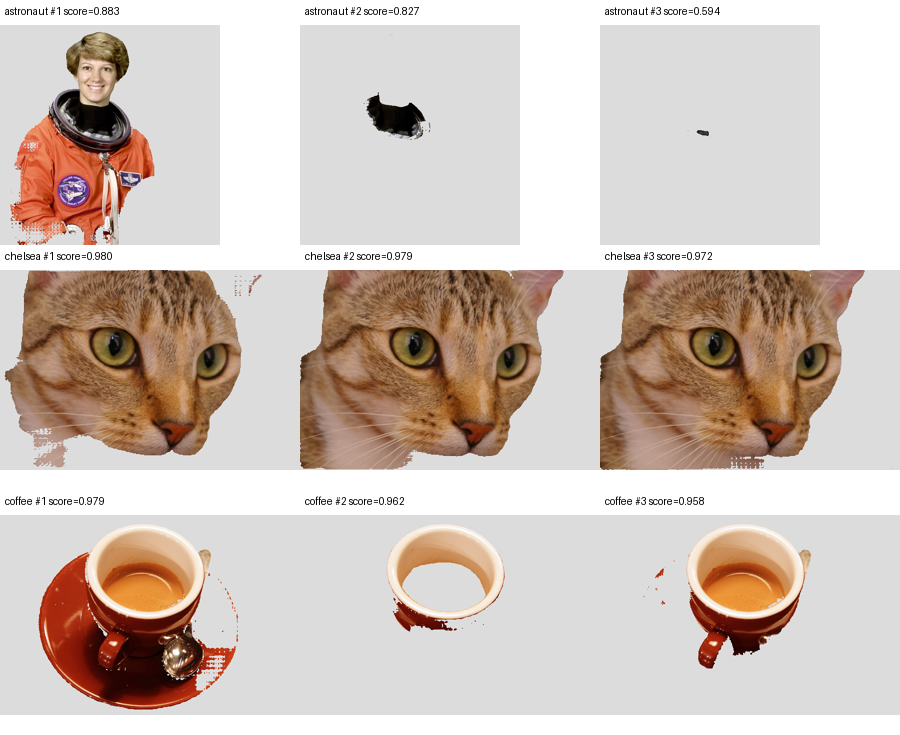

# 担当Bの性能・品質・環境再現の評価

測定日：2026年10月13日。Apple M1 Pro、メモリ32GiB、macOS 27.0.1 arm64、OpenJDK 17.0.19、Python 3.12.14。AIはMobileSAM / MPSです。

## 結果の要点

- 2Kの全12操作でウォーム3回の中央値が1秒未満でした。最大半径20のぼかしを改善し、2Kで約1.02秒から0.30秒、4Kで約4.75秒から1.43秒へ短縮しました。
- 画像登録から最初の候補取得まで、2Kで約192ms、4Kで約335msでした。モデルロード・ウォームアップは別途約3.69秒です。HTTP・UI・Java側の画像転送時間は含みません。
- 人物・猫・カップの公開写真3枚で候補を取得して目視確認しました。輪郭欠けや背景混入があり、候補切替・追加クリックを必要とします。正解マスクがないためIoUや精度の合格判定はしていません。
- PSD9ケースの再構成表示は、psd-toolsの合成結果と白背景上で比較して最大1階調の差でした。実際のPhotoshop出力や調整・効果を広く網羅した比較ではありません。
- 新しい独立した仮想環境で、core構成とAIを含む完全構成の導入・通常テスト49件・起動・終了を再現しました。完全構成では実モデル推論も確認しました。

## Java画像処理

処理対象は1920×1080、3840×2160の半透明を含む決定的なパターン画像です。入力はARGB_PRE、出力生成と処理内の入力コピーを計測に含め、入力画像生成・ファイル入出力は含めません。Resizeは縦横1/2、Cropは四辺10px、Blurは最大半径20、Mosaicは12px、色調整は明るさ20・コントラスト1.2・彩度0.8です。

同一JVMを使い、操作ごとに初回1回と追加3回を計測しました。「初回」はその操作の初回であり、JVM起動直後の完全なコールド条件ではありません。追加計測前にGCを要求しますが、実行はJVMに委ねられます。ヒープ値は追加3回の各ヒーププールのピーク合計で、同時点の使用量や必要最小ヒープではありません。入力と出力も含みます。JVMの上限は2GiBです。

| 操作 | 2K中央値 ms | 4K中央値 ms | 4K最大 ms | 4Kヒーププールピーク合計 MiB |
| --- | ---: | ---: | ---: | ---: |
| CROP | 25.4 | 112.1 | 114.0 | 129.4 |
| ROTATE_RIGHT | 61.1 | 249.4 | 249.6 | 97.9 |
| ROTATE_LEFT | 61.2 | 248.9 | 252.5 | 97.9 |
| FLIP_H | 58.8 | 235.5 | 235.5 | 97.9 |
| FLIP_V | 59.1 | 235.7 | 236.3 | 97.9 |
| RESIZE | 58.0 | 228.5 | 229.1 | 73.9 |
| COLOR_ADJUST | 91.7 | 392.2 | 394.1 | 129.5 |
| GRAYSCALE | 84.3 | 299.9 | 302.7 | 129.5 |
| SEPIA | 82.1 | 301.1 | 301.2 | 129.5 |
| NEGATIVE | 85.6 | 290.2 | 291.2 | 129.5 |
| BLUR | 301.5 | 1428.4 | 1445.2 | 134.4 |
| MOSAIC | 68.7 | 243.8 | 244.1 | 133.9 |

ぼかしは分離Gaussianの式と加算順を保ち、縦方向の計算を連続したチャンネル配列の走査へ変更しました。境界位置やリングバッファの検索を画素・チャンネルごとに繰り返さず、横方向の行バッファも再利用します。独立した2次元畳み込みとの既存比較テストを通過しています。4Kではまだ約1.43秒かかるため、UIでの連続プレビューには縮小画像の利用が必要です。

元データ：[改善前](java-before.jsonl)、[改善後](java.jsonl)。他アプリの負荷やJIT・GCで計測値は変動するため、固定の性能保証やCIの時間制限には使用しません。

## AIとメモリ

登録はPNGの復号・埋め込み生成を、候補取得はマスクのPNG化・Base64化を含みます。モデル内だけの演算時間ではありません。サービスのHTTP通信とJavaFX画面は含みません。追加クリックは負点を追加した要求の3回実行です。

| 寸法 | 登録 ms | 初回候補 ms | 追加候補中央値 ms | 追加候補最大 ms | 登録画像のキャッシュ MiB | プロセスRSS累積ピーク MiB |
| --- | ---: | ---: | ---: | ---: | ---: | ---: |
| 1920×1080 | 154.8 | 36.8 | 38.8 | 70.3 | 9.9 | 626.5 |
| 3840×2160 | 251.0 | 83.7 | 85.9 | 92.2 | 27.7 | 745.6 |

512×512画像で登録→推論→解放を300回実行しました。終了時のキャッシュ件数と削除待ちIDはともに0件でした。最後の50回のRSSは499.9～504.7MiB、AI評価までの累積ピークは804.5MiBでした。この短期反復で単調な増加は観測していませんが、数時間の連続運用やGPUメモリリークがないことを証明するものではありません。RSSはCPU側の常駐メモリで、MPSの使用量全体を表す指標ではありません。

## 写真による切り抜き確認

各画像に正点1個・負点1個を与えました。クリック座標、候補score、選択面積比は[実測JSON](python.json)に記録しています。scoreはモデルの推定値で、実測の切り抜き精度ではありません。



- 人物：第1候補は顔・上半身を選択しますが、服の一部が欠けます。第2・第3候補は部品に近い小さな領域です。
- 猫：候補ごとに顔・耳・首周辺の範囲が異なり、毛の境界と背景の混入が残ります。
- カップ：カップ＋受け皿、内側、カップ本体に候補が分かれます。受け皿やスプーン付近に欠け・混入があります。

この3例では対象候補を返せることを確認しました。自動的に正確な全対象が切り抜けるという受入判定はせず、A側の候補切替・追加クリック画面と接続して最終評価します。

評価素材はscikit-image v0.25.2の公開写真です。astronautはNASAのパブリックドメイン画像、chelseaはStefan van der Walt、coffeeはRachel MichettiのCC0画像として[公式データ説明](https://scikit-image.org/docs/0.25.x/api/skimage.data.html)に記載されています。派生した候補図にもこの出典を適用します。取得URLとSHA-256は[画像manifest](../../tools/validation-images.json)に固定し、元写真はキャッシュへ取得します。

## PSDの表示比較

通常ラスタ、pass-through、グループ透明度、非表示、multiply、40層、2K/4Kの4層、上限500ノードのPSDを生成して取り込み、描画用ノードだけを再合成しました。比較相手はpsd-tools 1.24.0の合成結果です。白背景に合成してRGBを比較するため、完全透明画素のRGB差を無視します。

| ケース | 取り込み ms | 資産数 | 警告数 | 最大RGB差 / 255 |
| --- | ---: | ---: | ---: | ---: |
| plain | 2.1 | 3 | 0 | 1 |
| pass-through | 2.0 | 3 | 0 | 1 |
| isolated-opacity | 2.7 | 2 | 1 | 1 |
| hidden | 2.9 | 2 | 1 | 0 |
| multiply | 3.9 | 1 | 1 | 0 |
| 40-layers | 14.0 | 41 | 0 | 1 |
| 2K-layers | 64.0 | 4 | 0 | 1 |
| 4K-layers | 256.0 | 4 | 0 | 1 |
| 500-nodes | 161.3 | 500 | 0 | 1 |

4K多層の入力生成・取り込み・参照合成・比較までを含む評価プロセスのRSS累積ピークは約2.40GiBでした。これはサービスのPSD取り込み単体のピークではなく、AIモデルと参照画像・比較用配列も同じプロセスに含みます。資源上限を定めたまま、実利用のPSDで取り込み単体のピークを追加測定する余地があります。

生成PSDだけの比較であり、Photoshopで作成されたType・Shape・SmartObject・調整・効果を含む多様な実PSDの互換性評価は引き続き必要です。

## クリーンなPython環境

新規venvを作り、ユーザーsite-packagesを無効にして導入・検証した後、venvと子サービスを削除・終了しました。ソースとモデルはリポジトリにあるものを使用しています。

- core：事前取得したwheelだけを使い、ネットワークなしで導入。pip check、通常テスト49件、動的ポート起動、AIなしでもPSD利用可能、終了を確認。
- 完全構成：固定ロックから新規導入。pip check、通常テスト49件、動的ポート起動、モデル準備成功、実MPS推論、終了を確認。

完全構成の導入で、既存依存huggingface_hub 2.2.0が要求する間接依存httpx2とhttpcore2の版が未固定であることが分かり、2.13.1へ固定しました。必要性は[Hugging Faceの固定版setup.py](https://github.com/huggingface/huggingface_hub/blob/v2.2.0/setup.py)、出所と依存関係は[HTTPX2の公式PyPIメタデータ](https://pypi.org/pypi/httpx2/2.13.1/json)と[HTTPCore2](https://pypi.org/pypi/httpcore2/2.13.1/json)で確認しました。推論中のモデル自動取得は行いません。

[coreの結果](clean-environment.json)、[完全構成の結果](clean-environment-ai.json)。これは同じMac内の新規Python環境であり、OSを入れ直した端末や別の評価PCでの確認ではありません。

## 再現方法

リポジトリのルートで実行します。性能評価には完全なPython依存と配置済みモデルが必要です。

```sh
python3 tools/build.py --compile-tests
java -Xmx2g -Djava.awt.headless=true -cp app/build/classes:app/build/test-classes editor.ProcessingBenchmark 3
python-service/.venv/bin/python tools/validate_b.py --cycles 300
python-service/.venv/bin/python tools/verify_clean_environment.py --ai
```

core構成のオフライン再現：

```sh
python-service/.venv/bin/python -m pip download -r python-service/requirements-core.lock --dest .cache/core-wheels
python-service/.venv/bin/python tools/verify_clean_environment.py --wheelhouse .cache/core-wheels
```

公開画像の初回取得と完全構成の導入にはネットワーク、起動確認には127.0.0.1での通信が必要です。生成PSD・マスク・生データはGit対象外のreports/validationへ出力します。この文書のJSONと候補図は測定時のスナップショットです。
